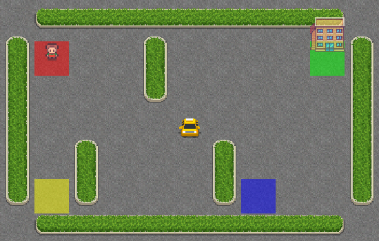
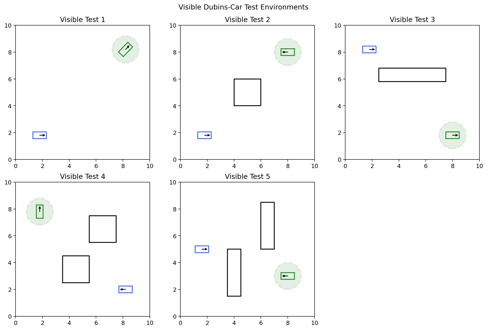
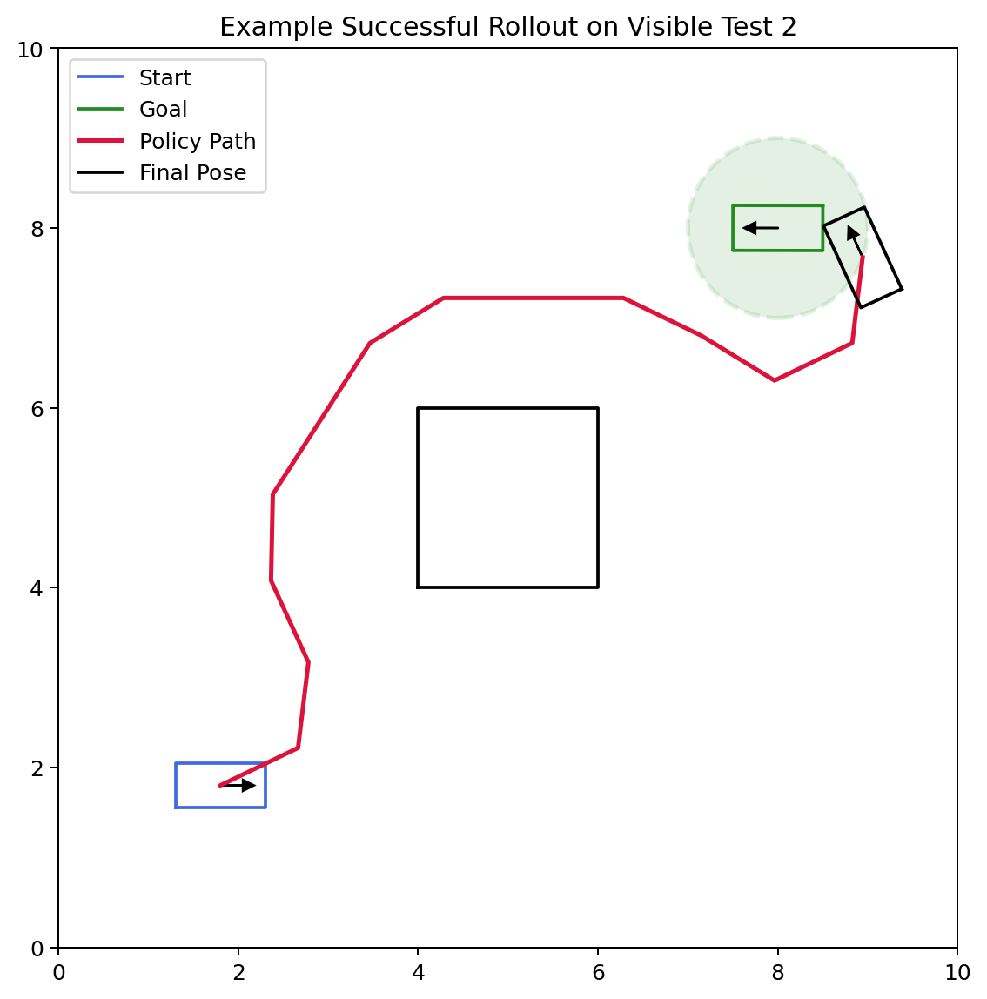
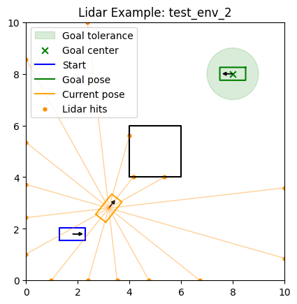
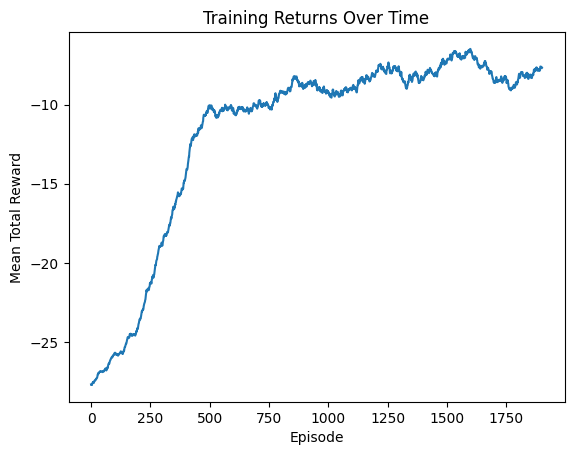

# CS440 Online Fall 2026, MP 5: Reinforcement Learning
## Due: Sunday, November 1, 2026, 11:59 PM CST

## I. Overview

In this MP you will implement:

1. Tabular Q-learning for a small discrete environment
2. A linear DQN agent for a Dubins car environment

As in the earlier MPs, a lot of code is already provided for you. Your job is to fill in the missing learning logic and, for the Dubins car part, design a useful hand-crafted feature representation.

## II. Getting Started

**Use Python 3.10 or newer** (apologies if you were previously using 3.9). From the `template/` directory, install the assignment dependencies:

```bash
python -m pip install -r requirements.txt
```

All commands below assume your terminal is in the `template/` directory. Look through the starter files there.

Files relevant to Part III:

* `tabular_q_learning.py` - you will edit and submit this

Files relevant to Part IV:

* `linear_dqn.py` - you will edit and submit this
* `gym_robot.py` - you will edit and submit this
* `cspace.py` - no need to copy from MP3, we provide it for you
* `robot.py` - no need to copy from MP3, we provide it for you
* `data/` - create `train_env_*.json` files here; five visible test environments are provided for evaluation

## III. Tabular Q Learning (50 points)

In this part you will implement tabular Q-learning for the [Gymnasium Taxi-v4 environment](https://gymnasium.farama.org/environments/toy_text/taxi/).

You will find `TODO(III)` markers in `tabular_q_learning.py`. The main tasks are:

* initialize the Q-table
* implement epsilon-greedy action selection
* implement the Q-learning update
* implement the training loop
* optionally implement a separate greedy evaluation helper

Part III is worth 50 points: Q-table initialization and action selection are worth 8 points, the Q-learning update is worth 14 points, the training loop is worth 8 points, and the learned policy stored in `QAgent_weights.npy` is worth 20 points. You are free to tune hyperparameters such as `alpha`, `gamma`, `epsilon`, and `init_val`.

The `experiments` dictionary at the bottom of `tabular_q_learning.py` controls the hyperparameters and whether weights are saved. Modify it as needed, then run:

```bash
python tabular_q_learning.py
```

Use `python tabular_q_learning.py --seed <integer>` to repeat an experiment with another fixed seed. You may add helper functions or classes as needed.

### The Taxi Environment

<figure align="center">
    
    <figcaption align="center"><b>Taxi-v4 example render with the taxi near the center of the map, the passenger at `R` (the red tile), and the destination at `G` (the green tile).
</b></figcaption>
</figure>

We highly recommend that you read through the official Taxi environment documentation to understand the details of the environment. Here we provide a brief summary.

Taxi-v4 is a small gridworld in which a taxi must:

1. drive to the passenger,
2. pick the passenger up,
3. drive to the passenger's destination, and
4. drop the passenger off.

The environment is small enough that a simple tabular method works very well.

The image above can be rendered using `env.render()` after you create the environment with `render_mode="rgb_array"`. For simpler debugging in terminal the environment also supports an ASCII render that looks something like:

```text
+---------+
|R: | : :G|
| : | : : |
| : : T : |
| | : | : |
|Y| : |B: |
+---------+
```

### Spaces, Actions, Rewards, and Episodes

Each Gymnasium environment provides:

* `env.observation_space`
* `env.action_space`

For Taxi-v4 with the default arguments:

* observation space: `Discrete(500)`
  * `env.observation_space.n == 500`
* action space: `Discrete(6)`
  * `env.action_space.n == 6`

The six actions are:

* `0`: move south
* `1`: move north
* `2`: move east
* `3`: move west
* `4`: pick up passenger
* `5`: drop off passenger

Reward structure:

* `-1` for a normal step
* `+20` for a successful drop-off
* `-10` for illegal pickup/drop-off actions

Taxi-v4 also supports optional rainy transitions and a fickle passenger. This assignment uses the defaults (`is_rainy=False`, `fickle_passenger=False`), so movement is deterministic and the state/action spaces, rewards, and 200-step limit described here apply.

Episode end conditions:

* `terminated=True` when the passenger is successfully dropped off
* `truncated=True` if the environment time limit of 200 steps is reached

When training, stop an episode when:

```python
done = terminated or truncated
```

When updating the Q-table, however, use only `terminated` to decide whether to bootstrap or to use the immediate reward by itself.

### What the Observation Means

The Taxi observation is a single integer state id. You do not need to decode it into a specific state of the world since for tabular Q-learning we can use it directly as the row index into your Q-table.

### The Gym API

The basic loop is:

```python
state, info = env.reset()
next_state, reward, terminated, truncated, info = env.step(action)
```

### What to Implement in `tabular_q_learning.py`

#### 1. `QAgent.__init__(...)`

Initialize `self.q_table` as a NumPy array with:

* shape `[n_states, n_actions]`
* dtype `float`
* all values set to `init_val`

#### 2. `QAgent.act(state, epsilon=0.0)`

Implement epsilon-greedy action selection:

* with probability `epsilon`, choose a random action
* otherwise choose the best action according to the Q-table, breaking ties with the first occurrence of the maximum value (that is, `np.argmax` behavior)

#### 3. `QAgent.update(...)`

Implement the standard Q-learning update:

```text
target = reward                              if terminal
target = reward + gamma * max_a' Q(s', a')   otherwise

Q(s, a) <- Q(s, a) + alpha * (target - Q(s, a))
```

`QAgent.__init__`, `QAgent.act`, `QAgent.update`, and `train_agent` are all graded directly for correctness. The optional `eval_agent` helper is not called by the autograder. Your saved Q-table is graded independently for policy performance.

#### 4. `train_agent(...)`

Implement the training loop over episodes:

1. reset the environment
2. pick an action using epsilon-greedy exploration
3. call `env.step(action)`
4. update the Q-table
5. accumulate reward
6. stop when `terminated or truncated`

Return one total reward per training episode for the plotting functions in `__main__` to display your training results.

Notice that the autograder tests this function correctness, but does not retrain your agent.

#### 5. `eval_agent(...)`

We recommend writing a separate greedy evaluation helper with `epsilon=0.0`. The helper itself is not graded, but this matches the greedy policy that the autograder extracts directly from your saved Q-table.

### Saved Weights

Submit your best trained Q-table as a NumPy file named `QAgent_weights.npy`. When saving is enabled, the provided runner writes this file beside `tabular_q_learning.py` and prints the full path. The runner uses seed 440 by default; pass `--seed <integer>` to repeat an experiment with a different fixed seed.

## IV. Linear DQN for a Dubins Car (50 points)

In this part you will implement a linear function approximator for DQN in a Dubins car environment. Training can be slow because the agent runs for many timesteps across multiple environments and each step requires collision checking. Start this part early enough to leave time for several experiments.

In MP4 you wrote linear models of the form:
$$y = X A$$

Here you will again use a linear model, but now each action has its own weight vector:
$$ Q(s, a) = \phi(s)^T w_a $$

where:

* $\phi(s)$ is your hand-designed feature vector for state $s$
* $w_a$ is the weight vector for action $a$

Note that for convenience we will store the weights as a single matrix $W$, i.e., a linear function with multiple outputs.

Your job is to:

1. design $\phi(s)$ in `gym_robot.py`
2. implement the linear DQN code in `linear_dqn.py`
3. create your own `train_env_*.json` training environments
4. train a policy and save `linear_dqn_weights.npy`

### Environment Summary

<table align="center">
    <tr>
        <td align="center"></td>
        <td align="center"></td>
    </tr>
    <tr>
        <td align="center"><b>The 5 visible Dubins-car test environments provided for you. Notice that the actual heading of the goal is visualized but not relevant to the task. All that matters is the position of the goal and radius around it.</b></td>
        <td align="center"><b>An example successful rollout on one of the provided visible test environments. The green disk shows the goal-tolerance region. The dynamics include action noise; the provided test helper uses a fixed seed so repeated local tests are reproducible.</b></td>
    </tr>
</table>

The underlying robot is a Dubins-style car with a fixed set of three controls and stochastic transitions (noise added to these controls):

* left turn
* straight
* right turn

Each episode:

* starts from the `start` pose in the JSON file
* ends immediately on collision
* ends successfully when the pose at the end of an action is within `goal_tolerance` of the goal **position** (not configuration, meaning the final heading does not matter)
* truncates after `30` steps if the goal has not been reached

The reward for each action is:

* `-30` if the car collides; the episode terminates
* `+10` if the car reaches the goal region; the episode terminates
* otherwise, the distance to the goal before the action minus the distance after it

Thus, an ordinary step has positive reward when the car moves closer to the goal and negative reward when it moves farther away. The `+10` goal reward replaces the ordinary distance-change reward on the successful step. Notice that this reward for moving towards the goal is a *shaped reward* that we provide. In general this is something you might tune yourself but for this assignment leave it as is.

When writing your training loop end an episode when `done = terminated or truncated` just like in the Taxi environment. And again, when computing the DQN target, only use `terminated` to decide whether to bootstrap from the next state.


### What You Need to Implement

#### 1. `gym_robot.py`

The environment already handles:

* Dubins-car dynamics
* collision checking
* lidar ray casting
* rewards
* the fixed 3-action control set

Your main responsibility in this file is the observation function:

* define a useful feature vector in `make_observation(...)`
* use information such as the goal direction, goal distance, heading, and lidar distances
* return a **1D NumPy array** of finite, real-valued numeric features
* keep the shape and dtype consistent across all calls to `make_observation(...)`

The `GymDubinsCar` class uses the very first observation returned by `reset()` to define `observation_space`, so consistency matters. If your first observation has a different shape from later observations, your training and evaluation code will break.

Because the Q-function is linear, feature engineering matters more here than it would in a deep-network implementation. You may use interaction terms, nonlinear transformations of raw inputs, or other information extracted from the robot state and environment. One key hint is that our *action space is discrete* and therefore to make your function's job easier you may want to create some *discrete features*, features that answer *categorical* questions such as "is there an obstacle within a certain distance in a certain direction?" or "is the goal far to the left of my current heading, close to straight, or far to the right?". Designing working features is not easy, especially because it can be hard to decide if what's going wrong are your features or your training (described below). You will need to experiment and find a good balance and a training procedure that allows you to draw meaningful conclusions.

#### 2. `linear_dqn.py`

Implement the linear DQN logic, including:

* weight initialization
* epsilon-greedy action selection
* replay buffer storage
* the DQN update using a target network and sampling from the replay buffer
* a single-environment training episode in `run_episode(...)`
* your multi-environment experiment in `train(...)`

A separate greedy evaluation helper is already provided.

Part IV is worth 50 points: the required observation, agent, update, and episode implementations are worth 20 points, and the saved policy is worth 30 points.

Some useful type/shape expectations:

* observations are 1D NumPy arrays of features
* `self.weights` should be a floating-point 2D NumPy array of shape `[num_features, num_actions]`
* `self.target_weights` should initially be an independent copy of `self.weights` with the same shape
* `act(...)` should compute `features @ self.weights` and return an integer action index in `[0, num_actions - 1]`, except when epsilon-greedy exploration chooses a random action. Greedy ties should select the first maximum, as `np.argmax` does

The core update is still the usual DQN target:

```text
target = reward                                     if terminated
target = reward + gamma * max_a' Q_target(s', a')   otherwise
```

Append transitions to your replay buffer, throwing away the oldest elements once you reach `self.max_buffer_size`. Once the buffer contains at least `batch_size` transitions, sample `batch_size` transitions without replacement and update the online weights. Use the target network only for the next-state value, and replace it with an independent copy of the online weights after every `target_weights_update_freq` completed gradient updates.

For making the update we now need to use the gradient instead of making a direct update to a Q-table. The gradient here is the same linear-regression gradient you implemented in MP4. Recall that MP4 used predictions $XA$ and the mean-squared error

$$
L(A) = \frac{1}{N}\lVert XA-y\rVert_2^2,
$$

whose gradient was

$$
\nabla_A L(A) = \frac{2}{N}X^T(XA-y).
$$

For a DQN batch of size $B$, each row has a feature vector $\phi_i \in \mathbb{R}^d$, one selected action $a_i$, and a scalar TD target $y_i$:

$$
q_i = Q(s_i,a_i) = \phi_i^T w_{a_i},
$$

$$
y_i =
\begin{cases}
r_i, & \text{if the transition terminated},\\
r_i + \gamma \max_{a'} \phi(s'_i)^T w^-_{a'}, & \text{otherwise},
\end{cases}
$$

where $w^-_{a'}$ is a column of the target-network weights. The idea is that these $y_i$'s are our labels (we do not differentiate through them) and we will try and make our function, $q_i$, closer to these labels. We'll use the half mean-squared TD loss

$$
L(W) = \frac{1}{2B}\sum_{i=1}^{B}(q_i-y_i)^2.
$$

The factor $1/2$ cancels the factor $2$ that appeared in the MP4 MSE gradient. For one transition, the chain rule gives

$$
\nabla_{w_{a_i}}\frac{1}{2}(q_i-y_i)^2
= \frac{\partial \frac{1}{2}(q_i-y_i)^2}{\partial q_i}
  \nabla_{w_{a_i}}q_i
= (q_i-y_i)\phi_i.
$$

Therefore, for each action column $w_a \in \mathbb{R}^d$, the batch gradient is

$$
\nabla_{w_a}L(W)
= \frac{1}{B}\sum_{i:a_i=a}(q_i-y_i)\phi_i.
$$

The complete gradient has the same shape as $W$, namely `[num_features, num_actions]`. A transition contributes only to its selected action column. The gradient step is

$$
w_a \leftarrow w_a - \alpha \nabla_{w_a}L(W).
$$

#### 3. `run_episode(...)`

Implement one complete training episode in one environment:

1. Reset the environment and use the returned observation as the current state.
2. Call `agent.act(state, epsilon=epsilon)` and pass that action to `env.step(...)`.
3. Pass the complete transition to `agent.update(...)`, including
   `learning_rate`, `discount_factor`, and `batch_size` through the corresponding
   `alpha`, `gamma`, and `batch_size` arguments.
4. Propagate `next_state` and accumulate the undiscounted reward.
5. Stop when either `terminated` or `truncated` is true, but pass only
   `terminated` to `agent.update`, since a time-limit truncation still has a
   valid next-state value from which to bootstrap.
6. Return the episode's total undiscounted reward.

#### 4. `train(...)`

Build your longer experiment around `run_episode(...)`. You may choose how to
sample the training environments, whether to use a curriculum, how often to
change epsilon, and which learning statistics to retain. If you change its
arguments or return value, update the provided `__main__` block accordingly.

The starter's default arguments are reasonable starting values, not a prescribed
or guaranteed-best configuration. They support a simple baseline: make repeated
passes over all environments, begin with `epsilon_start`, and linearly reduce
epsilon to `epsilon_end` over `epsilon_decay_steps` passes. Returning the mean
total reward from each pass gives you one value per pass that you can plot as a
training-return curve. You may use another schedule or statistic. Be mindful
that visiting every environment once per pass makes total experience grow with
the number of environments.

The provided `test(...)` helper performs a reproducible greedy evaluation and
saves a trajectory plot.

### Training Environments

You are expected to create your own training environments. Don't ignore this step just because it isn't graded directly!

Only files named `data/train_env_<number>.json`, where `<number>` is an integer, are loaded for training. For example:

```text
data/train_env_1.json
data/train_env_2.json
```

Each file has the same structure as the provided test environments. Keep the
robot, motion, tolerance, and boundary parameters unchanged. You should edit:

* `start`: the initial pose `[x, y, theta]`
* `goal`: the goal pose `[x, y, theta]` (the goal check ignores `theta`)
* `obstacles`: a list of polygonal obstacles

Each obstacle is a list of at least three `[x, y]` vertices in counterclockwise
order. The final vertex is connected back to the first automatically. For example,
one square obstacle is written as:

```json
"obstacles": [
    [[4.0, 4.0], [6.0, 4.0], [6.0, 6.0], [4.0, 6.0]]
]
```

Use `"obstacles": []` for an empty workspace. Use simple, non-self-intersecting
polygons inside the boundary, and choose start and goal poses where the entire
car is collision-free.

A simple workflow is:

1. copy one of the provided visible test JSON files
2. rename it using the `train_env_<number>.json` pattern
3. change the `start`, `goal`, and obstacle layout

None of our hidden tests are extremely challenging but they do require a reasonable amount of training and a good feature design to pass. We recommend starting with simple environments and then gradually increasing the difficulty as you iterate on your design.

<table align="center">
    <tr>
        <td align="center"></td>
        <td align="center"></td>
    </tr>
    <tr>
        <td align="center"><b>An example lidar visualization showing the current robot pose, lidar rays, hit points, and the goal-tolerance region.</b></td>
        <td align="center"><b>Example training return curve from a run in which the initial epsilon was decayed to 0.2 over 500 training passes and then held constant.</b></td>
    </tr>
</table>

After implementing Part IV and creating at least one training environment, use a short run to check that the complete pipeline works:

```bash
python linear_dqn.py --num_episodes 5
```

Then choose suitable training settings and run `python linear_dqn.py`. Each run
gets a new directory under `results/`. To test weights from a completed run
without training again, use:

```bash
python linear_dqn.py --test_only --weights_file results/run_1/linear_dqn_weights.npy
```

Run `python linear_dqn.py --help` to see the remaining options.

### Visible and Hidden Test Environments

We provide **5 visible test environments** in `data/test_env_1.json` through
`data/test_env_5.json`. Your saved policy is evaluated on those environments and
10 additional hidden environments, for a total of **15**.

Your code correctness is worth 20 points and the saved-policy evaluation is worth 30 points: full credit requires success in **at least 10 of the 15** test environments, with proportional partial credit below that threshold.

We strongly recommend that you do **not** train directly on the 5 visible test environments at first. Instead, treat them like a validation set while you iterate on:

* your feature design
* your training environments
* your hyperparameters

Once you have settled on a final design, you may also include the visible test environments in your final training run.

### Saved Weights

The code runs each experiment in a new directory under `results/run_<experiment_number>`. It saves `linear_dqn_weights.npy` in that directory along with test results and plots. Choose your best run and submit that weights file with the exact name `linear_dqn_weights.npy`. The runner uses seed 440 by default; use `--seed <integer>` to reproduce a run or deliberately compare several training seeds.

In `gym_robot.py`, do not change the provided dynamics, action-noise magnitude, rewards, or episode limit. Limit your code changes there to the feature representation and any feature helpers it needs.

## Submission Instructions

Upload exactly these five files to Gradescope:

* `tabular_q_learning.py`
* `gym_robot.py`
* `linear_dqn.py`
* `QAgent_weights.npy`
* `linear_dqn_weights.npy`

Do not upload training-environment JSON files, the `results/` directory, or provided support files such as `cspace.py` and `robot.py`. Make sure `linear_dqn_weights.npy` was trained with the final feature vector in your submitted `gym_robot.py`. Remove high-volume debugging prints, especially output produced every step; occasional experiment summaries are fine. Access Gradescope from the Launch App button in Coursera so your grade is synchronized.

## Policies

You are expected to be familiar with the general policies on the course syllabus, including academic integrity. In particular, this is an individual assignment and you may not use external sources to write significant parts of your code for you.
